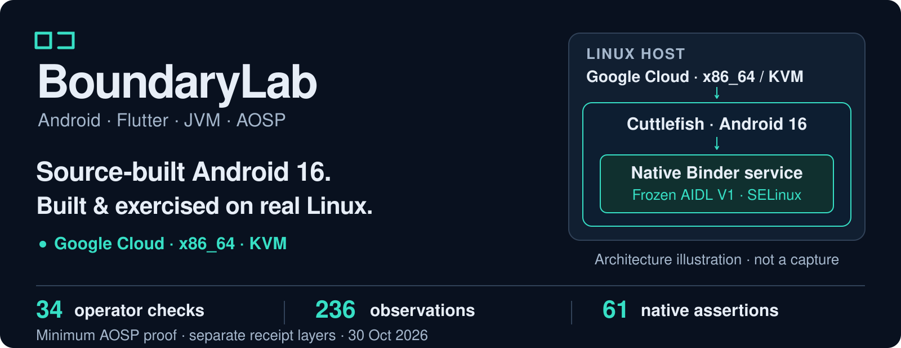
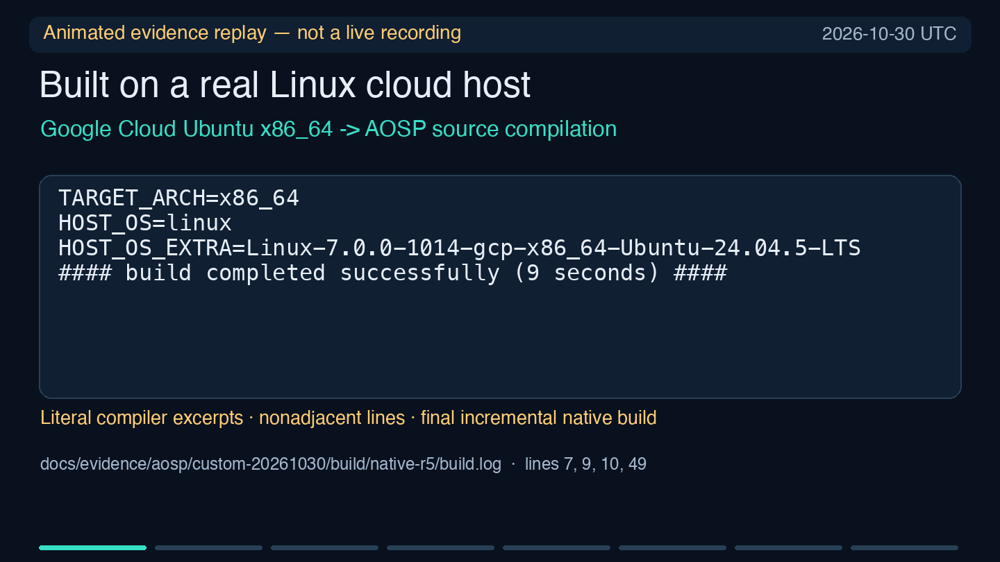
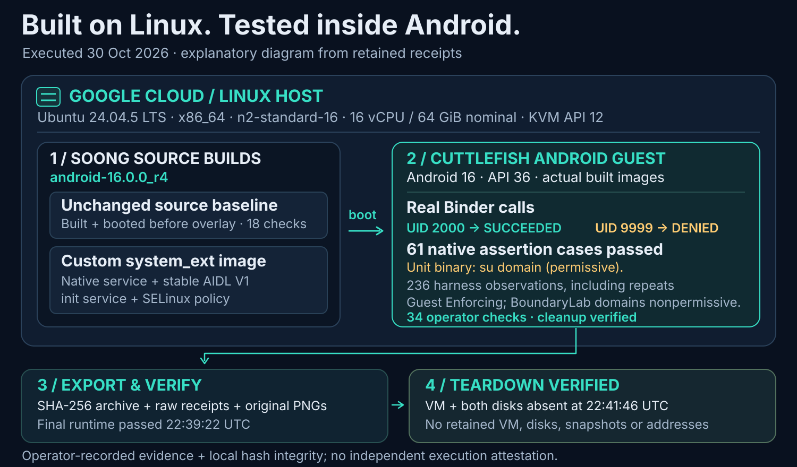
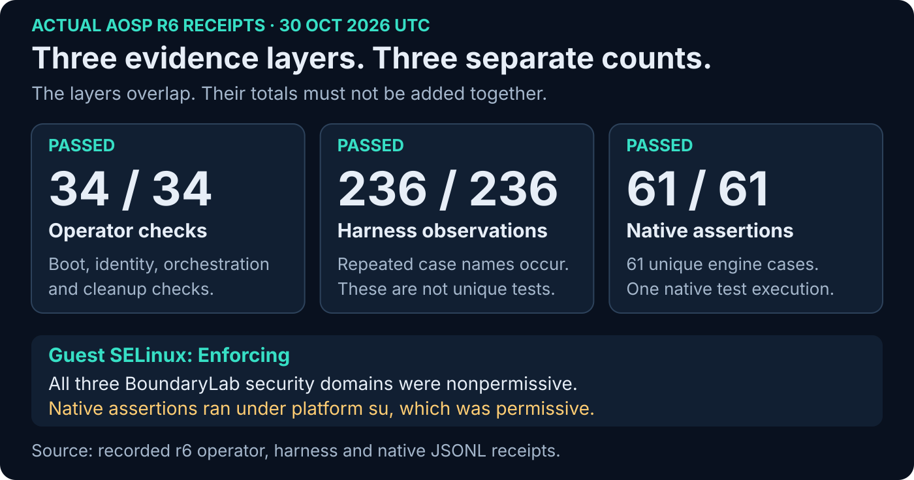
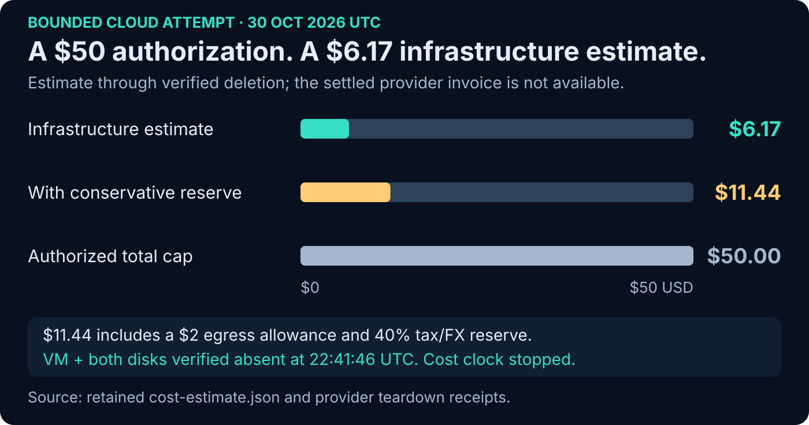
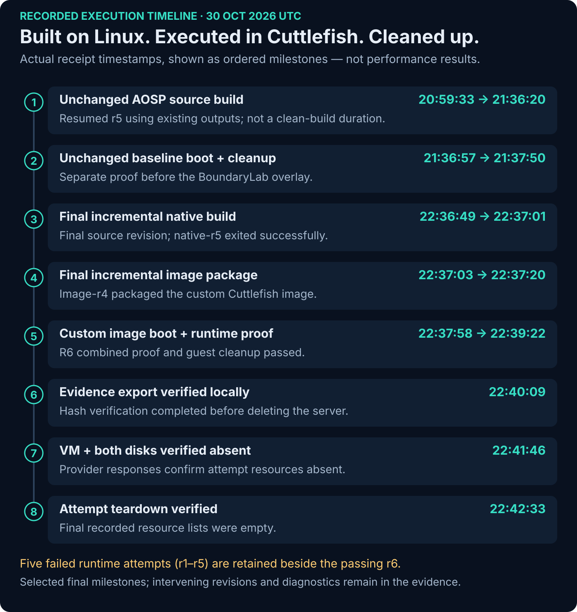
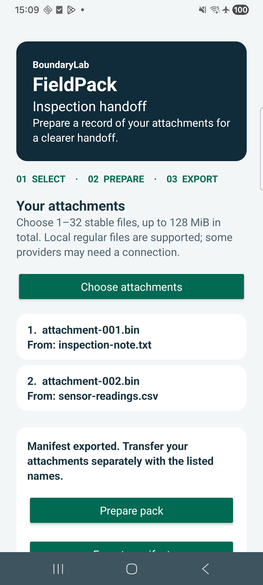
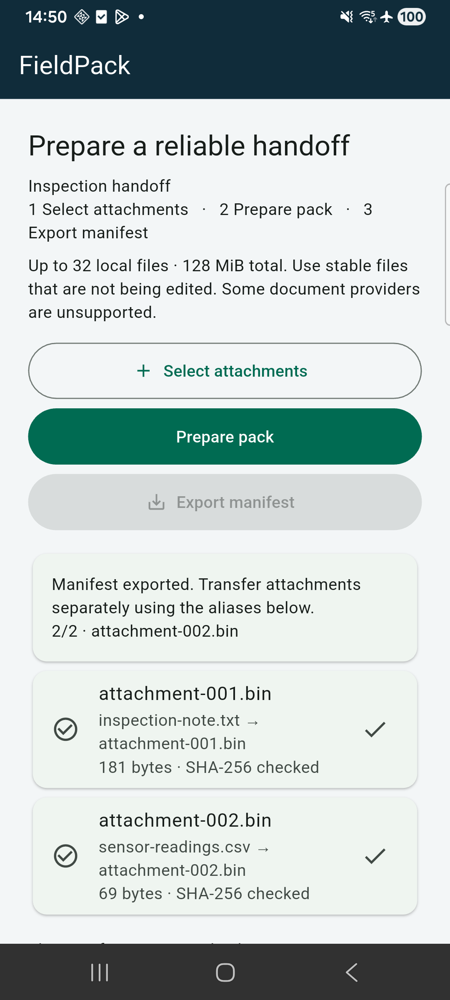
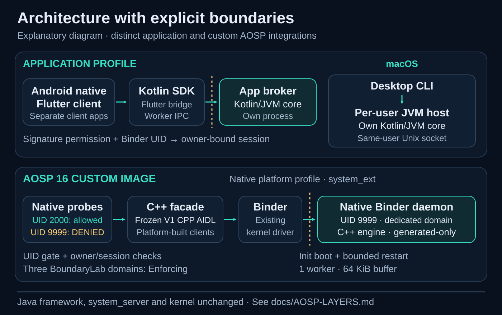

# BoundaryLab

**Bounded middleware, from app clients to a source-built Android 16 system image.**

[5 hosted lanes passed (recorded run)](https://github.com/oudaykhaled/boundarylab/actions/runs/41141910969) · [Apache-2.0](LICENSE)



*Architecture illustration. Every execution claim below links to retained receipts.*

[**Evidence gallery**](docs/SHOWCASE.md) · [**Run locally**](#try-fieldpack-locally) · [**Architecture**](docs/AOSP-LAYERS.md) · [**Delivery board**](https://github.com/users/oudaykhaled/projects/3)

## Built and tested on a real Linux AOSP server

On **30 October 2026**, we built and booted the pinned Android 16 source baseline, then a custom native-service image, on a **Google Cloud Linux x86_64 server with KVM**. The host ran Ubuntu 24.04 with **16 vCPU, 64 GiB nominal RAM (62.8 GiB reported) and a 500 GiB SSD workspace**. This was source-built Android running in Cuttlefish on that server. [Host/KVM receipts](docs/evidence/aosp/attempt-20261030/host-kvm.json) · [Allocated host inventory](docs/evidence/P01/README.md)

The [original native compiler log](docs/evidence/aosp/custom-20261030/build/native-r5/build.log#L9-L10) records the Linux host directly:

```text
HOST_OS=linux
HOST_OS_EXTRA=Linux-7.0.0-1014-gcp-x86_64-Ubuntu-24.04.5-LTS
```

**Pinned source:** `android-16.0.0_r4` · **Target:** `aosp_cf_x86_64_only_phone-bp4a-userdebug` · **Executed overlay:** [`444ae29`](https://github.com/oudaykhaled/boundarylab/commit/444ae29a31833616c465e155a3dc1335d061cda6).

| Recorded proof layer | Final result | Inspect the evidence |
|---|---:|---|
| Operator checks | **34 / 34 passed** | [Source, image, boot and cleanup aggregate](docs/evidence/aosp/custom-20261030/runtime/r6/run-result.json) |
| Harness observations | **236 / 236 passed** | [Real Binder/lifecycle checks](docs/evidence/aosp/custom-20261030/runtime/r6/smoke/checks.json) |
| Distinct native assertions | **61 / 61 passed** | [Original command and stdout](docs/evidence/aosp/custom-20261030/runtime/r6/smoke/058-command.json) |

These are separate layers; observations include repeated checks. **Native assertions ran under permissive `su`.** Live authorized Binder calls used UID 2000 / `boundarylab_probe`; the service and both probe domains were nonpermissive in the [loaded SELinux policy](docs/evidence/aosp/custom-20261030/runtime/r6/smoke/permissive-domains.json).

[](docs/media/readme/aosp-proof-replay.gif)

**Animated evidence replay — not a live recording.** Derived from retained commands and results. [Static poster](docs/media/readme/aosp-proof-poster.png) · [Replay transcript and provenance](docs/media/readme/README.md#animated-replay-transcript) · [Original execution evidence](docs/evidence/aosp/custom-20261030/README.md)

<details>
<summary><strong>Watch the 28-second recorded-evidence replay</strong></summary>


**Animated evidence replay — not a live recording.** Collapse this panel to return to the static view. [Read the transcript](docs/media/readme/README.md#animated-replay-transcript).

</details>

### Actual service execution

The AOSP component is a **headless native Binder service**. Its useful evidence is the work it executed and the callers it rejected.

**Authorized caller, UID 2000:** submitted one generated byte (`0x00`); the service returned the expected SHA-256 digest.

```text
{"case":"known_job_succeeded","passed":true,"detail":"6e340b9cffb37a989ca544e6bb780a2c78901d3fb33738768511a30617afa01d"}
```

[Recorded request, caller identity and returned digest](docs/evidence/aosp/custom-20261030/runtime/r6/smoke/012-command.json)

**Unauthorized caller, UID 9999:** received the typed `DENIED` result.

```text
I/BoundaryLabProbe( 4371): {"case":"denied","passed":true,"detail":"DENIED"}
```

[Recorded denied-client identity and response](docs/evidence/aosp/custom-20261030/runtime/r6/smoke/057-command.json)

**Separate native engine execution:** all 61 assertion cases passed under the recorded `su` identity.

```text
{"summary":"PASS","checks":61}
```

[Original native command and complete stdout](docs/evidence/aosp/custom-20261030/runtime/r6/smoke/058-command.json) · [Source baseline build/boot receipts](docs/evidence/P02/r5-source-baseline/README.md) · [Supporting boot-capture archive](docs/SHOWCASE.md#supporting-boot-captures)



*Execution pipeline diagram. [Actual Soong API update/freeze](docs/evidence/P03/api-freeze/README.md) → [native build](docs/evidence/aosp/custom-20261030/build/native-r5/build.log) → [image build](docs/evidence/aosp/custom-20261030/build/image-r4/build.log) → [runtime receipts](docs/evidence/aosp/custom-20261030/runtime/r6/run-result.json).*

The added AOSP components are a **native C++ facade, frozen AIDL V1, a dedicated `system_ext` Binder daemon, init definitions and SELinux rules**. This profile supports generated SHA-256 work; file jobs return `UNSUPPORTED`. The Java framework, `system_server` and kernel are unchanged. [Layer ownership and source](docs/AOSP-LAYERS.md)

<details>
<summary><strong>Open the results, cost and recorded-run timeline charts</strong></summary>



*Receipt-derived results. The 61 native assertions used permissive `su`; the three BoundaryLab domains were nonpermissive. Short restart and quiescent FD observations do not establish performance or soak. [Underlying results](docs/evidence/aosp/custom-20261030/actual-results.json).*



*Estimated infrastructure **US$6.17**; **US$11.44** including egress allowance and tax/FX reserve. Final invoice unavailable. Server and both disks were verified deleted at **22:41:46 UTC on 30 October 2026**. [Cost calculation and teardown receipts](docs/evidence/aosp/teardown-20261030/README.md).*



*Historical execution timeline. Five failed runtime attempts and their exact corrections remain [preserved](docs/evidence/aosp/custom-20261030/README.md). [All visuals and sources](docs/SHOWCASE.md).*

</details>

## A useful example: inspection attachments that can be checked

**FieldPack helps a recipient catch changed or missing attachments before working from the wrong files.** It demonstrates process isolation, bounded work and explicit recovery when a worker disappears.

An inspector selects attachments in the native Android or Flutter client. A separate Android application broker hashes them; the client explicitly exports a SHA-256 manifest. The recipient receives the manifest and attachments separately, then verifies a local directory through a separate desktop JVM host or the Python reference.

<table>
  <tr><th>Native Android — actual export</th><th>Flutter — actual export</th></tr>
  <tr>
    <td align="center"><a href="docs/evidence/build/native-exported-post-loss-api36.png"></a></td>
    <td align="center"><a href="docs/evidence/build/flutter-exported-final-api36.png"></a></td>
  </tr>
</table>

Both clients exported the same **299-byte manifest**. Separate JVM and Python recipient implementations agreed on all five outcomes: **matching, changed, truncated, missing and unsupported symlink**—10 JVM and 10 Python cases across the two exports. [Original handoff results](conformance/desktop/mobile-handoff.json) · [Observed broker-loss defect and verified fix](docs/case-studies/broker-loss.md)



*Architecture diagram. FieldPack uses the application broker; the native AOSP profile is a separate integration. [File/job contract](docs/FIELDPACK.md) · [Wire contract](contracts/PROTOCOL-V1.md).*

## Try FieldPack locally

Requires **Git and Python 3.10+ on macOS or Linux/POSIX**. Uses only the standard library; after cloning, the reference demo runs offline.

```sh
git clone https://github.com/oudaykhaled/boundarylab.git
cd boundarylab
python3 examples/fieldpack/demo.py
```

The demo creates a manifest from three owned fixtures, verifies copied files, changes a byte, removes an attachment and rejects an unsupported format. Its expected final marker is `PASS: all expected outcomes and exit codes observed`. This single-process reference runs independently of the recorded AOSP image. [Walkthrough and custom files](examples/fieldpack/README.md)

## Explore or build an implementation

| Goal | Start here |
|---|---|
| Native Android application and broker | [Native client](examples/android-native/README.md) · [Binder broker](android/broker/README.md) · [Kotlin SDK](sdk/kotlin/README.md) |
| Flutter application and plugin | [Flutter consumer](examples/flutter/README.md) · [Flutter SDK](sdk/flutter/README.md) |
| Separate-process desktop host and CLI | [Desktop quickstart](desktop/README.md) · [Conformance results](conformance/desktop/README.md) |
| Native AOSP source integration | [AOSP profile](aosp/README.md) · [Layer diagram](docs/AOSP-LAYERS.md) |

<details>
<summary><strong>Pinned application toolchains and local check commands</strong></summary>

JDK 17, Android SDK 36 / build-tools 35.0.0, Gradle 8.13, AGP 8.11.1 and Kotlin 2.2.21; Flutter 3.38.9 / Dart 3.10.8. Desktop file support needs a trusted local C compiler. Android installation minimum is API 30; actual local device evidence is API 36.

```sh
python3 scripts/verify-wrapper.py
python3 scripts/check.py reference
python3 scripts/check.py jvm
python3 scripts/check.py android
python3 scripts/check-flutter.py
```

These commands check/build applications; they do not install a device or provision AOSP infrastructure. The local Flutter receipts record the equivalent direct Dart analyzer used where the wrapper analyzer was incomplete; CI uses the complete pinned SDK.

Broker and both Android consumers **must have matching signing certificates**. Build them with the same local signing setup or use the matched three-APK CI bundle. The separately signed denial fixture is intentionally rejected. [Build/runtime quality report](docs/evidence/build/QUALITY.md)

</details>

## Evidence, scope and next work

The engineering prototype has actual app, desktop and AOSP execution evidence. **393 selected host cases** and **31 physical-device cases** passed at the recorded application source, with one hardlink fixture explicitly unavailable; those counts are separate from the AOSP proof above. [Quality report](docs/evidence/build/QUALITY.md) · [Current requirement evidence](docs/IMPLEMENTATION-STATUS.md) · [AI acceptance audit](docs/evidence/reviews/AOSP-ACCEPTANCE-MAP.md)

Work is bounded: 32 flat aliases, 128 MiB per file and pack, 64 KiB reads, 16 KiB manifest, fixed resource caps and one worker. Jobs and sessions are volatile; process loss requires a fresh epoch and explicit resubmission. Matching hashes establish byte consistency. [Security and supported file profile](SECURITY.md)

**Open:** compatibility evolution/old consumers, controlled performance and peak-resource measurement, the two-hour soak, fresh final-image reproduction and other declared roadmap acceptance. The [baseline's incremental-build/sandbox history](docs/evidence/P02/r5-source-baseline/README.md#limits-retained-from-the-actual-run) and [failed custom attempts](docs/evidence/aosp/custom-20261030/README.md#runtime-attempts-and-exact-failures) remain inspectable. No production release, commercial adoption or independent execution authenticity is claimed.

[Architecture decisions](docs/decisions/BUILD-DECISIONS.md) · [40-task plan and status](planning/EXECUTION-STATUS.md) · [22-item role evidence matrix](docs/REQUIREMENTS.md) · [Original animated proposal](presentation/README.md) · [Contributing](CONTRIBUTING.md) · [Evidence policy](docs/EVIDENCE-POLICY.md)

Created and maintained by [Ouday Khaled](https://github.com/oudaykhaled). [Apache-2.0](LICENSE).
