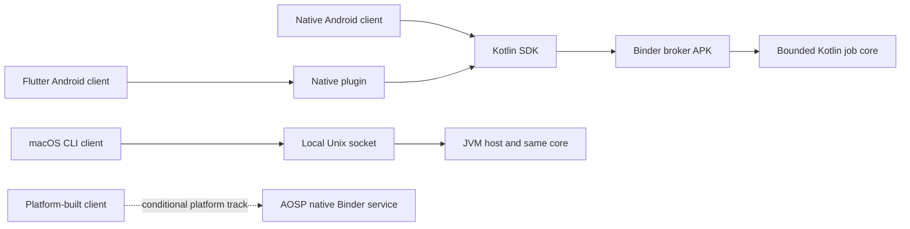

# BoundaryLab

**Inspectable local middleware, with a runnable file-integrity reference example.**

BoundaryLab proposes a small framework for bounded, cancellable local jobs, with native Android and Flutter consumers, a desktop host, and a gated Android platform implementation. Developers should be able to inspect how admission, identity, resource limits, process loss and compatibility behave instead of rebuilding that machinery in each application. A deterministic streaming checksum is the demonstration operation; the reusable asset is the middleware contract, SDK and conformance suite.

**Current status:** the [FieldPack Python reference](examples/fieldpack/README.md) runs on actual local files and has executable tests. Android Binder, Flutter, JVM host and AOSP middleware remain planned. There is no installable native product, measured native performance result or external adopter yet. Original material is licensed under [Apache-2.0](LICENSE).

Start with the [live GitHub delivery board](https://github.com/users/oudaykhaled/projects/3), [revised plan](docs/PLAN-V2.md) and [detailed tickets](planning/TICKETS.md). The revised scope supersedes the initial 40h/120h/240h estimates.

```sh
python3 -m unittest discover -s examples/fieldpack -v
python3 examples/fieldpack/demo.py
```

FieldPack checks whether separately supplied inspection attachments match a portable manifest. The demo shows matching, changed and missing files. Matching hashes establish byte consistency, not sender authenticity.

## Animated presentation

The [eight-scene browser presentation](presentation/README.md) explains the business value, process boundaries, failure semantics and evidence roadmap. Open its `index.html` locally for offline playback, with pause, scene navigation and reduced-motion support. [Speaker notes](presentation/SPEAKER-NOTES.md) accompany the animation. The motion illustrates proposed behavior; it is not recorded middleware execution.

## Read the plan

| Document | What you can assess |
|---|---|
| [Architecture and contract](docs/ARCHITECTURE.md) | Real process boundaries, trust model, lifecycle, failure semantics and platform track |
| [Revised roadmap](docs/PLAN-V2.md) | Real example, leaf estimates, dependencies, gates and evidence rules |
| [FieldPack contract](docs/FIELDPACK.md) | Manifest, real-file safety, exact limits and platform boundaries |
| [Initial roadmap](docs/ROADMAP.md) | Archived original 40h / 120h / 240h hypotheses |
| [Requirement evidence matrix](docs/REQUIREMENTS.md) | All 22 mapped items from the [target role](https://www.linkedin.com/jobs/view/4476561682/), acceptance and honest gaps |
| [Executable-work backlog](planning/BACKLOG.md) | Work packages with owners, dependencies and evidence gates |
| [Benchmark and fault protocol](docs/VERIFICATION.md) | Falsifiable experiments, measurements, failures and reproducibility |
| [Five-minute reviewer demo](docs/DEMO.md) | What a future reviewer should be able to reproduce |
| [Independent proposals and decision](planning/DECISION.md) | Ten Astra reports, tradeoffs, selection rubric and synthesis |
| [Progress board](planning/BOARD.md) | Planning, implementation, review and verification tracked separately |

Track the [GitHub issues](https://github.com/oudaykhaled/boundarylab/issues), [delivery board](https://github.com/users/oudaykhaled/projects/3) and [milestones](https://github.com/oudaykhaled/boundarylab/milestones). Existing work packages are epics; detailed child tickets carry the estimates and acceptance evidence. Only completed, checked work is marked Done.

## Proposed scope



The [revised plan](docs/PLAN-V2.md) adds bounded real-file processing through FieldPack. Generated bytes remain a controlled IPC/scheduler benchmark. The first desktop target is **macOS with a separate JVM host and CLI**; the conditional AOSP service remains generated-only and needs a booted, enforcing image on suitable Linux resources. The reference example proves manifest semantics, not these native boundaries.

This plan was prepared for the Sparagus **Principal Architect — OS Middleware & System Frameworks** vacancy, reviewed on 30 October 2026. The client is unnamed. The requirement matrix also identifies experience that software cannot manufacture: education, commercial shipment, sustained European employment and genuine partner or international collaboration. No hiring outcome is promised.

## Contribute or assess

Start with [CONTRIBUTING](CONTRIBUTING.md), [evidence policy](docs/EVIDENCE-POLICY.md), [primary sources](docs/SOURCES.md) and [security scope](SECURITY.md). The Python reference quickstart is executable today. Native source directories and future build commands in the tickets are proposals until the corresponding modules exist. Ten independent GPT-6 Astra agents produced isolated proposals; the coordinating agent selected and reconciled the final scope. Agents are not external adopters or independent human reviewers.
