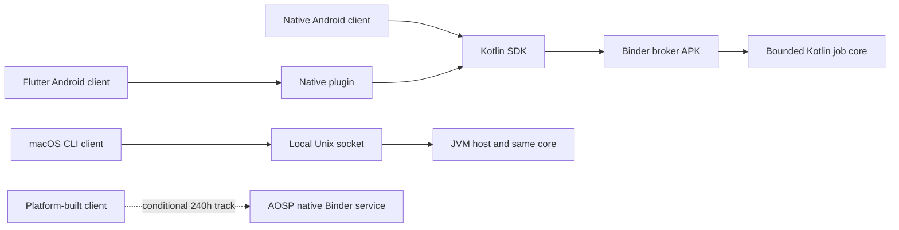

# BoundaryLab

**A project plan for inspectable middleware across application ecosystems.**

BoundaryLab proposes a small framework for bounded, cancellable local jobs, with native Android and Flutter consumers, a desktop host, and a gated Android platform implementation. Developers should be able to inspect how admission, identity, resource limits, process loss and compatibility behave instead of rebuilding that machinery in each application. A deterministic streaming checksum is the demonstration operation; the reusable asset is the middleware contract, SDK and conformance suite.

**Current status: planning only.** There is no product implementation, installable application, measured performance result or external adopter yet. The initial repository contains the consolidated plan, implementation backlog and ten independent research proposals. Original material is licensed under [Apache-2.0](LICENSE).

## Read the plan

| Document | What you can assess |
|---|---|
| [Architecture and contract](docs/ARCHITECTURE.md) | Real process boundaries, trust model, lifecycle, failure semantics and platform track |
| [Roadmap](docs/ROADMAP.md) | 40h / 120h / 240h gates, dependencies, estimates, contingencies and stop rules |
| [Requirement evidence matrix](docs/REQUIREMENTS.md) | All 22 mapped items from the [target role](https://www.linkedin.com/jobs/view/4476561682/), acceptance and honest gaps |
| [Executable-work backlog](planning/BACKLOG.md) | Work packages with owners, dependencies and evidence gates |
| [Benchmark and fault protocol](docs/VERIFICATION.md) | Falsifiable experiments, measurements, failures and reproducibility |
| [Five-minute reviewer demo](docs/DEMO.md) | What a future reviewer should be able to reproduce |
| [Independent proposals and decision](planning/DECISION.md) | Ten Astra reports, tradeoffs, selection rubric and synthesis |
| [Progress board](planning/BOARD.md) | Planning, implementation, review and verification tracked separately |

## Proposed scope

- **40h target:** prove real Android IPC, two client ecosystems, denial, cancellation and explicit process-loss behavior.
- **120h target:** add one real PC implementation, compatibility checks, controlled measurement and a reproducible release candidate. Reserve 20 hours for uncertainty.
- **240h target:** add a booted AOSP service with enforcing security policy, platform-facing API and executed tests, subject to early Linux build-host feasibility. This is the strongest planned evidence for OS middleware depth.

Hours are proposed effort caps, not delivery promises. Scope gates require actual evidence. The initial desktop target is **macOS with a JVM CLI**, chosen to avoid requiring another host for the first PC demonstration. Linux, Windows, iOS, ChromeOS and Fuchsia are unimplemented. The AOSP track needs separate suitable Linux resources.

This plan was prepared for the Sparagus **Principal Architect — OS Middleware & System Frameworks** vacancy, reviewed on 30 October 2026. The client is unnamed. The requirement matrix also identifies experience that software cannot manufacture: education, commercial shipment, sustained European employment and genuine partner or international collaboration. No hiring outcome is promised.

## Contribute or assess

Start with [CONTRIBUTING](CONTRIBUTING.md), [evidence policy](docs/EVIDENCE-POLICY.md), [primary sources](docs/SOURCES.md) and [security scope](SECURITY.md). There is intentionally no product quickstart until runnable modules exist. Future source directories and commands in the plan are proposals. Ten independent GPT-6 Astra agents produced isolated proposals; the coordinating agent selected and reconciled the final scope. Agents are not external adopters or independent human reviewers.
