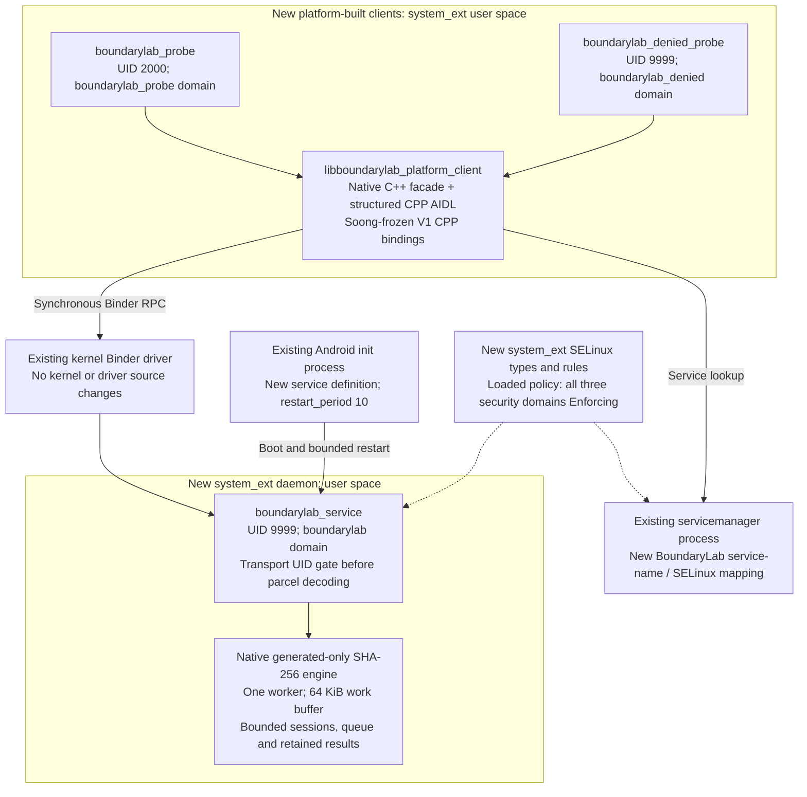

# Native AOSP profile: layers and ownership

Status: the pinned Android 16 unchanged baseline and custom image both built and booted.
The completed native-service run at `444ae29a31833616c465e155a3dc1335d061cda6` passed
236 harness check records and 61 native assertions, with source/image identity,
loaded-policy enforcement and cleanup verified. [Runtime evidence](evidence/aosp/custom-20261030/README.md)
preserves all five earlier failed attempts and their corrections.

Both test-client domains deliberately have narrow discovery/call rules. The denied
fixture reaches the independent transport-UID check and must produce typed `DENIED`
through the facade. It is not a SELinux discovery-denial test. UID 2000 is a deliberate
userdebug test principal; this is not a production application authorization scheme.

The facade calls generated platform C++ Binder bindings. It is statically linked into
the deliberate native clients, not exposed through a new Java `framework.jar` API.
The stock-Android downloadable examples continue using the separate app broker.

| Layer | Change in this profile | Evidence |
|---|---|---|
| Cuttlefish product/build | Product package/property include and BoardConfig policy include | Overlay before/after hashes, pinned manifest and actual Soong build logs |
| Internal AIDL | Structured `boundarylab-platform` interface and generated CPP bindings; no VINTF declaration | Real update/freeze output, generated API snapshot/hash and committed build definition |
| Native clients | Platform-built facade and authorized/denied probes | Target compile/link and real typed Binder outcomes |
| Native service | Dedicated `/system_ext/bin/boundarylab_service`, generated-only engine | Image placement, automatic boot registration, PID/domain and operation receipts |
| Init and SELinux | New `.rc` definition, file/service contexts and narrow policy rules | Observed restart intervals, reviewed source policy and loaded enforcing policy |
| Java framework / `system_server` | No source extension or daemon placement here | Source integration inspection and observed dedicated process |
| Linux kernel / Binder driver | Existing target kernel and driver; no kernel implementation | Pinned target/build provenance; no custom-kernel claim |

The [unchanged baseline](evidence/P02/README.md) is distinct from the earlier public
Android 17 host preflight. [Real API-freeze receipts](evidence/P03/api-freeze/README.md)
and committed V1 bytes precede the custom compile. The
[executed source checkpoint](evidence/aosp/custom-20261030/runtime/r6/source-checkpoint.json)
binds the 33 overlay-file hashes and actual native-r5/image-r4 receipts. The
[image preparation](evidence/aosp/custom-20261030/runtime/r6/preparation.json) records
image, installed-binary and host-tool hashes; the
[completed runtime checks](evidence/aosp/custom-20261030/runtime/r6/smoke/checks.json),
[61 native assertions](evidence/aosp/custom-20261030/runtime/r6/smoke/058-command.json)
and [run/cleanup result](evidence/aosp/custom-20261030/runtime/r6/run-result.json)
provide the corresponding execution evidence.

Root access is used for artifact/test-fixture preparation, native engine tests, policy
and process observations, and lifecycle control. Actual positive Binder calls independently
assert UID 2000 and the `boundarylab_probe` domain; the denied init client asserts Android
`AID_NOBODY` 9999 in `boundarylab_denied`. The daemon also uses Android's `nobody` identity.
The initial POSIX-UID assumption remains visible in historical failures and reviews.

The [minimum harness](../aosp/scripts/device-smoke.py) executed selected vectors,
denial, client death, three restart intervals, stale/fresh epochs and exact quiescent
resource recovery. These observations do not establish old-consumer evolution,
peak resources, performance, long-duration soak or fresh final-image reproduction.

Source: [build modules](../aosp/Android.bp), [facade](../aosp/client/Client.cpp),
[daemon](../aosp/service/main.cpp), [init definitions](../aosp/service/boundarylab.rc)
and [policy](../aosp/sepolicy/private/boundarylab.te).
