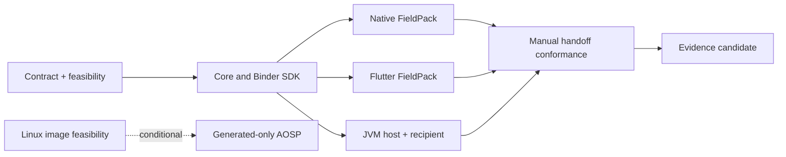

# BoundaryLab plan v2: deliver FieldPack through real boundaries

Revised 2026-10-30 using [ten independent Astra reviews](../planning/reviews-v2/README.md). This plan, the [file contract](FIELDPACK.md) and [detailed tickets](../planning/TICKETS.md) supersede the initial 40h/120h/240h scope and dependency assumptions. The original proposal documents remain historical inputs.

## What the user gets

An inspector selects a small set of attachments, processes them through BoundaryLab and explicitly exports a portable manifest. The recipient separately obtains the files, supplies a local directory and checks for matching, changed, missing or unsupported attachments. A failed or cancelled pack cannot be presented as a complete successful export. Logical aliases must match the separately transferred filenames.

Business hypothesis: fewer handoff mistakes and a shared integration contract for native and Flutter applications. A single application might reasonably use an in-process library. The broker's value is shared ownership, limits, cancellation, process isolation and observable failure semantics; faster hashing is not assumed. A checksum compares bytes and does not authenticate a sender.

**Already executed:** [Python reference CLI](../examples/fieldpack/README.md), three owned attachment files, 12 tests and normal/optimized walkthroughs. See [execution evidence](../examples/fieldpack/EVIDENCE.md) and [independent AI review](../planning/reviews-v2/REFERENCE-REVIEW.md). **Planned:** all native middleware, installed clients, JVM host and AOSP execution. The reference cannot close those gates.

## Selected scope

- Keep `generated-sha256-v1` as the controlled compute/scheduler/IPC comparison. Add `regular-file-sha256-v1` for actual bounded files; storage cost is reported separately.
- Freeze 32 flat portable aliases, 128 MiB per file **and pack**, 64 KiB reads and 16 KiB manifest. The [contract](FIELDPACK.md) defines exact schema, duplicate-key rejection, ownership and all queue/session/retention caps.
- Android supports tested read-only, regular, seekable whole-file descriptors. The client opens under its own authorization; the broker never reopens a URI/path with its authority. No large document byte arrays in Binder or Dart messages.
- Cancellation is cooperative. Running work retains its worker until cleanup; blocked storage cannot be given an invented hard deadline. Process death means lost/unknown, fresh epoch and explicit user resubmission.
- Native and Flutter assemble manifests from successful individual jobs. The workflow is neither an atomic multi-file snapshot nor durable execution. New attempts rehash every selected file.
- macOS has two actual JVM processes and independently proven rooted-file access. Java Unix sockets are not assumed to transfer FDs. Unsupported safety primitives block the file capability or require a separately reviewed helper.
- The conditional AOSP service remains **generated-only**, booted on one pinned Linux/Cuttlefish target with enforcing policy. Privileged user-file processing is deferred.

Larger packs, recursive paths, arbitrary streaming/cloud providers, signed manifests, durable/exactly-once jobs, sync, a desktop GUI and kernel work are outside this revision. Choosing a file in Android's picker does not prove that a provider is local or offline; record the tested provider profile.

## Ticket structure and sequence

The existing B01–B16 issues remain epics; B17 owns FieldPack. Forty detailed child tickets carry value, scope, acceptance, proposed implementer role, priority, prerequisite keys, focused-hour ranges, verification, evidence paths, risks and requirement IDs. No real person is assigned without accepting implementation ownership. Root is the sole writer of the project board.

Start **C01** target feasibility and **C02** contract adoption independently. C03/C04 supply the bounded core, A01/A02 the Binder/SDK baseline. Native, Flutter and desktop then branch from their actual prerequisites. FP01 establishes cross-implementation file vectors, FP02 adds descriptor ownership, and FP03 supplies the first installed FieldPack journey. FP04/FP05 extend Flutter/JVM; FP06 proves the actual manual handoff. Faults, compatibility and measurement join only when their tested paths exist. Image-resource inventory may happen early; AOSP remains an optional separate gate.

## Effort and gates

| Work | Unique leaf estimate | Acceptance |
|---|---:|---|
| Reference | 6–12h historical planning range | Executed Python checks; this is not a measured time log |
| G1 Android boundary/two-client proof | 64–122h | Installed native/Flutter consumers, generated vectors, authorization, loss and lifetime proofs |
| G2 FieldPack/PC/evidence extension | 128–246h additional | Actual files, JVM recipient, handoff, faults, compatibility, controlled measurement and clean-consumer rehearsal |
| G3 conditional AOSP extension | 62–124h additional | Booted native generated service, enforcing policy, platform API, restart/compatibility, measured investigation and reproduction |
| Core cumulative, including reference | **198–380h** | Reference + G1 + G2 |
| All tracks cumulative | **260–504h** | Core + conditional G3 |

After the verified reference, remaining base estimates are **192–368h for core**, or **254–492h including G3**. Sum each leaf once; epic rollups are not additional effort. These ranges include ordinary fixes, tests and docs; no separately funded contingency, waiting time or independent reviewer availability is included. Keep a visible uncertainty allowance when scheduling. Re-estimate after contract adoption, descriptor/provider tests, the first cross-language file pass and baseline-image feasibility. Do not force new scope into the former caps.

At 20 focused hours/week the remaining core estimate is roughly 10–19 weeks before external waits. This is arithmetic for one implementer, not a promised delivery date. Independent graph branches support switching during blockers; they do not reduce total labor for one person. Stop and split/re-estimate any leaf whose feasibility invalidates its 16h upper bound.

## Board workflow and completion

Use the [public GitHub Projects board](https://github.com/users/oudaykhaled/projects/3). Priority, gate, task/epic and example labels support filtering; milestones retain the three delivery gates. Native parent/sub-issue links and blocked-by dependencies distinguish hierarchy from prerequisites.

| State | Required meaning |
|---|---|
| Planned | Reviewed scope; no implementation completion implied |
| Ready | Prerequisite artifacts, target access, implementer and executable checks confirmed |
| In Progress | An implementer has actually started |
| In Review | Concrete diff and scoped execution evidence available |
| Done | All scoped acceptance verified; commit/environment/command/results and review method recorded |
| Blocked | Exact missing resource/decision/dependency, unblock condition and next step recorded |

Dependency waiting is visible in native blocked-by links; do not label every unstarted task as a resource incident. A reference Done card does not close B17 or a native milestone. An epic closes only after required children and gate acceptance reconcile. Compilation, device execution, physical measurement and image boot are distinct evidence classes. Skipped checks stay incomplete; honest negative research findings may complete the experiment but cannot pass an implementation gate.

## Review decisions and hiring evidence

The ten AI reports remain inspectable. Root selected the bounded contract, deduplicated work and resolved conflicting suggestions. Larger pack budgets and AOSP FD hashing in some proposals were rejected. The reference review found compact-output, alias-replacement and optimized-demo issues; fixes and regression checks are recorded. Final ticket contract review is linked from the review index.

The [22-item requirement matrix](REQUIREMENTS.md) remains a map of evidence to produce, not a claim that every job requirement is satisfied. R13 education/equivalence, R20 actual external partners, R21 sustained European experience and R22 international collaboration require authentic personal/external evidence. A release rehearsal cannot manufacture commercial shipment; self-authored samples and agents do not establish external adoption or human review.
