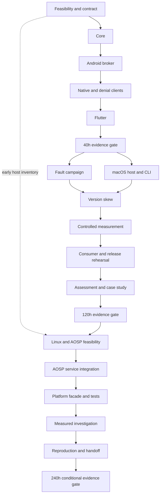

# Delivery roadmap

Status: proposed implementation, not work already completed. One accountable engineer is assumed. Independent people and usable hardware are external dependencies. No purchases, package-store releases or production deployments are included.

## Recommended sequence

Fund effort in gates: first a 40-hour Android boundary proof, then a 120-hour evidence package, then a conditional 240-hour platform track. For this particular role, the platform track is the strongest planned response to doubts about app-only experience. If its build prerequisites are unavailable, keep that gap explicit rather than treating the 120-hour artifact as equivalent.

| Gate | Cumulative effort target | Required evidence | What remains unproven |
|---|---:|---|---|
| G0 Feasibility | Inside first 6h | A clean Android sample executes; Flutter native build spike; JDK/macOS local-socket spike; reference device inventory; AOSP host availability assessed | Any middleware result |
| G1 Boundary proof | 40h | Separate broker/native/Flutter packages; same digest; owner denial; cancel; broker loss and explicit rebind/resubmit; raw trace | PC support, mature compatibility, defensible performance improvement, platform integration |
| G2 Evidence candidate | 120h | Actual macOS host/CLI conformance; bounded fault/load campaign; compiled version-skew fixtures; controlled startup/memory/latency report; fresh-consumer instructions | AOSP implementation, broad OS/device coverage, production reliability or commercial adoption |
| G3 Platform evidence | 240h, conditional | Booted AOSP service, build/init/policy changes, platform-facing facade, authorized/denied calls, restart and compatibility tests with SELinux enforcing; deeper measured case study | Kernel/driver work, industrial certification, commercial shipment and biographical/collaboration criteria |

G1 is aggressive if Flutter or signing setup is unfamiliar. If it misses the timebox, show a narrower prototype and leave R15 open; never replace native execution with a static mock. A partial gate is not a pass. The product remains unimplemented at plan publication.

## Work and reserves

The [backlog](../planning/BACKLOG.md) defines work packages B01–B16 and measurable acceptance.

| Stage | Packages | Nominal focused hours | Reserve | Cumulative |
|---|---|---:|---:|---:|
| Android boundary | B01–B05 | 40 | Borrow only from later reserve after explicit scope review | 40 |
| PC, hardening and evidence | B06–B11 | 60 | 20 | 120 |
| Platform integration and deeper proof | B12–B16 | 100 | 20 | 240 |

Estimates are planning judgments. Baseline package ranges total 74–140h before reserve; platform packages add 70–150h before reserve. Upper estimates cannot all fit 240h. Cut optional breadth or extend the estimate transparently; do not quietly omit an acceptance criterion. Unattended builds, download queues, thermal cooldown and waiting for human feedback add elapsed time even when they do not consume focused hours.

At 20 focused hours/week the three nominal gates are about 2, 6 and 12 weeks from kickoff. At 40h/week they are about 1, 3 and 6 weeks. These are capacity illustrations, not promised dates. The vacancy may close sooner; an early truthful artifact is useful, but this plan does not submit an application or contact anyone.

Arrows describe dependencies, not parallel people. One engineer performs the tasks sequentially; optional independent review does not remove implementation effort. Assess Linux resource availability early in B01, before choosing to pursue G3. B12 later verifies an actual clean baseline image before changing it.

## Prerequisites and stop rules

- Resolve target allocation, Android SDK/JDK/Gradle/Flutter compatibility, signing and physical benchmark access in B01. Presence of a tool executable is insufficient. Keep signing secrets and host/device profiles outside source.
- At hour 24, require a real remote call and denied caller. If absent, freeze new adapters and fix that boundary.
- At G1, require correct interruption semantics before adding desktop work. Cut visual polish first.
- At hour 80, reassess PC and Flutter readiness. If either cannot run reproducibly, leave that requirement open and spend remaining time on trustworthy evidence.
- At hour 108, freeze features and use the final baseline reserve for repeatability and docs.
- Before B13, require a buildable, booted baseline AOSP image on suitable existing resources. Current [AOSP host requirements](https://source.android.com/docs/setup/start/requirements) make this a material dependency; the Mac desktop target does not satisfy it. If unavailable, G3 is blocked by infrastructure. Do not purchase a builder or substitute an unexecuted patch.
- At hour 200, add no new platforms, runtimes or capabilities. Cut optional desktop GUI, second device and extra optimizations before weakening mandatory tests.

## Release and support intent

Use `plan-v1` for the planning snapshot. Future `v0.1.0` is an experimental Android boundary preview only after G1; `v0.2.0` is an evidence candidate after G2; `v0.3.0` adds the platform profile only after G3. A tag is not commercial shipment. Exact API support windows follow observed maintenance capacity, not an invented SLA.

CI will first gain executable modules in implementation PRs. Planned lanes: pure-core/contract checks; Android build/lint and IPC instrumentation; macOS host/CLI conformance; separate opt-in heavy AOSP image tests. Physical performance is a controlled manual/dedicated lane with raw evidence, not a timing badge from a shared hosted runner. No CI or application execution is claimed by this planning release.

## Scope discipline

Do not add Rust/C++, React Native, iOS, Linux desktop or a native GUI to the baseline solely to increase the technology count. Native C++ is justified later by the chosen AOSP service integration, with its own learning/setup allowance. Treat failed hypotheses and remaining career gaps as useful findings. Time spent cannot promote a planned item to verified status.
