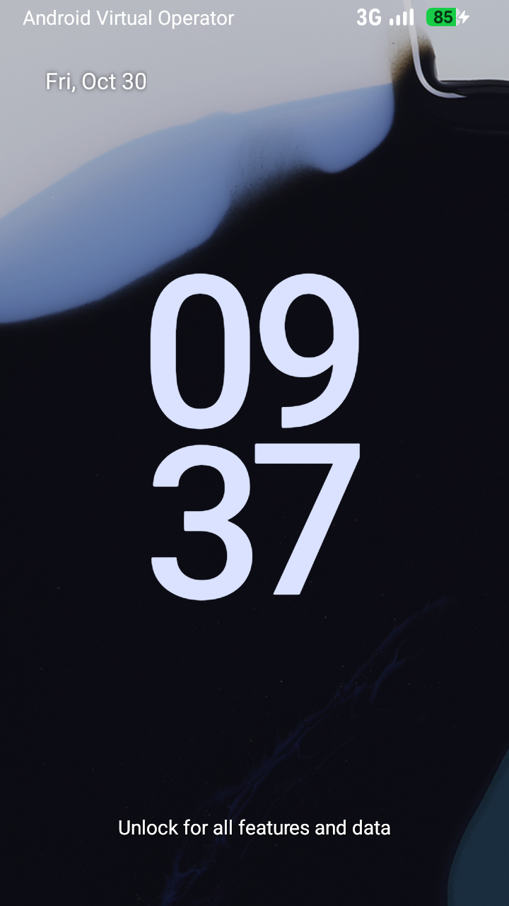
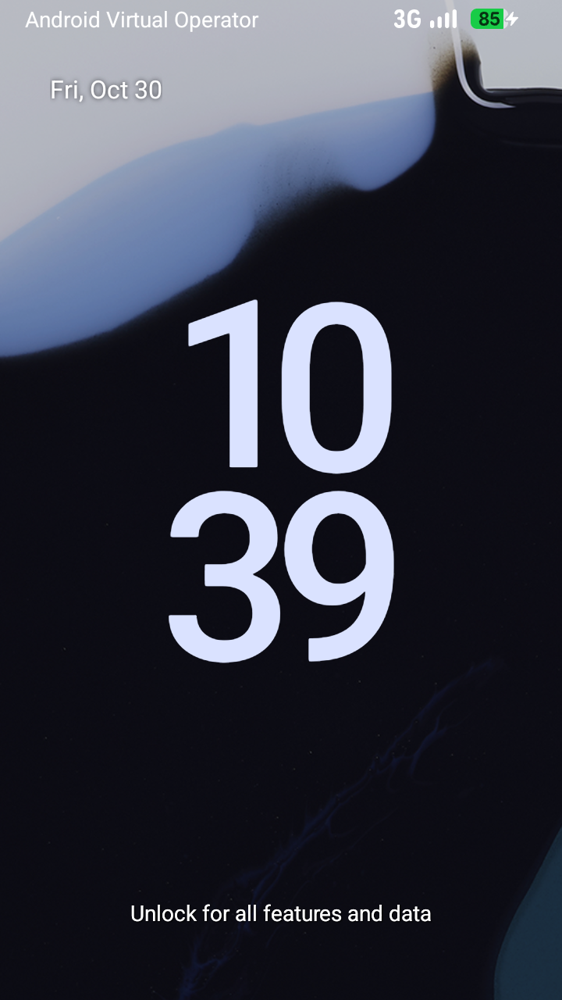
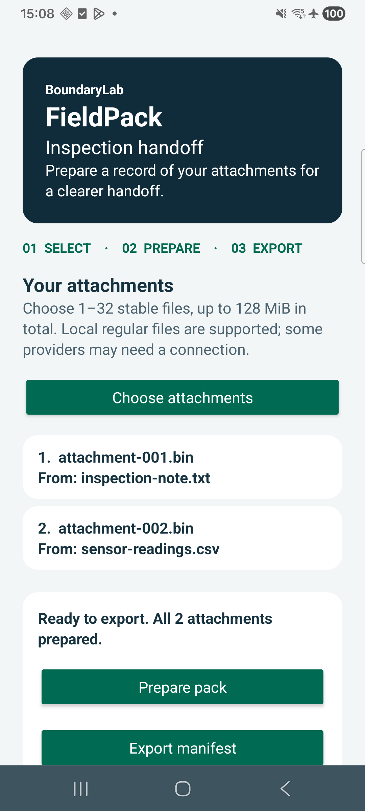
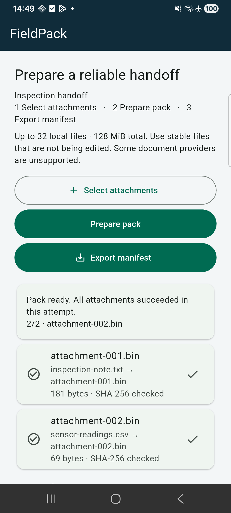

# BoundaryLab in action

**Built from Android 16 source on a Linux/KVM cloud server. Tested through real Binder calls. Captured before teardown.**

The images below are original execution captures from **30 October 2026**. Open an image for its full resolution, then follow the adjacent receipt to inspect the environment and result. The AOSP guest and the physical-phone app journeys are separate executed profiles.

[AOSP execution receipts](evidence/aosp/custom-20261030/README.md) · [Physical-device results](evidence/build/QUALITY.md) · [Architecture](AOSP-LAYERS.md) · [Project README](../README.md)

## Android 16, built and booted on Linux

The recorded Google Cloud host ran **Linux x86_64 with 16 CPUs, 64 GiB nominal RAM (62.8 GiB reported) and working KVM API 12**. Source-built images and their matching source-built Cuttlefish host binaries booted the pinned `android-16.0.0_r4` target. [Host/KVM receipt](evidence/aosp/attempt-20261030/host-kvm.json) · [Baseline source/build record](evidence/P02/r5-source-baseline/README.md) · [Final custom source checkpoint](evidence/aosp/custom-20261030/runtime/r6/source-checkpoint.json)

| Inspect the executed behavior | Recorded evidence |
| --- | --- |
| **34/34 operator checks** — image identity, installed binaries, profile, enforcement, final proof and cleanup | [Original final aggregate](evidence/aosp/custom-20261030/runtime/r6/run-result.json) |
| **236/236 harness observations** — real Binder goldens, caller identity, typed denial, session ownership, cancellation, death cleanup and restart/epoch checks | [Original harness checks](evidence/aosp/custom-20261030/runtime/r6/smoke/checks.json) |
| **61 unique native assertions, all true**, followed by the PASS/61 summary | [Original native command receipt](evidence/aosp/custom-20261030/runtime/r6/smoke/058-command.json) · [Extracted JSONL](evidence/aosp/custom-20261030/runtime/r6/native61.jsonl) |
| Actual loaded policy and relevant service/probe/denied domains | [Loaded policy](evidence/aosp/custom-20261030/runtime/r6/smoke/loaded-policy.bin) · [Permissive-domain analysis](evidence/aosp/custom-20261030/runtime/r6/smoke/permissive-domains.json) |
| Cloud VM and both disks absent after evidence export | [Verified teardown receipt](evidence/aosp/teardown-20261030/teardown.json) |

The 236 observations include repeated checks; the three counts describe different layers and are **not additive unique-test totals**. Authorized Binder probes ran as UID 2000 in `boundarylab_probe`; the denied client ran as Android UID 9999 in `boundarylab_denied`. Native engine assertions ran separately under `su`, whose domain was permissive. [Exact identity boundaries, earlier failures and remaining scope](evidence/aosp/custom-20261030/README.md)

## Supporting boot captures

Open the baseline and custom-image lock screens (boot context only)

<table>
  <tr>
    <th width="50%">1 · Unchanged source baseline</th>
    <th width="50%">2 · Custom image after the proof</th>
  </tr>
  <tr>
    <td align="center"></td>
    <td align="center"></td>
  </tr>
  <tr>
    <td><b>Captured 21:37:49 UTC.</b> Android 16 / API 36; fingerprint matches the built system; no BoundaryLab overlay; guest SELinux Enforcing. <b>18/18 baseline checks passed.</b> <a href="evidence/P02/r5-source-baseline/boot/result.json">Boot receipt and PNG hash</a> · <a href="evidence/P02/r5-source-baseline/build-result.json">Build receipt</a></td>
    <td><b>Captured 22:39:21 UTC.</b> Same pinned Android target with <code>generated-v1</code> profile. The final proof passed at 22:39:22 UTC, with guest Enforcing before and after. <a href="evidence/aosp/custom-20261030/runtime/r6/run-result.json">Proof receipt and PNG hash</a> · <a href="evidence/aosp/custom-20261030/build/image-r4/build-result.json">Final image-build receipt</a></td>
  </tr>
</table>

These lock screens show the actual booted virtual guests. **The service result is established by the command receipts below**: the native service has no graphical UI.

These are supporting boot captures, not demonstrations of the service doing work. The recorded Binder request/response and native execution above establish that behavior.

## FieldPack on a physical Android phone

The installed native Android and Flutter clients selected two owned files through Android DocumentsUI, prepared their manifest through the broker, and saved it through `ACTION_CREATE_DOCUMENT`. These captures came from a **physical Samsung SM-A336B, Android API 36**, independently of the AOSP Cuttlefish profile above.

<table>
  <tr>
    <th width="50%">Native Android · prepared</th>
    <th width="50%">Flutter · prepared</th>
  </tr>
  <tr>
    <td align="center"></td>
    <td align="center"></td>
  </tr>
  <tr>
    <td><b>30 October 2026.</b> Ready state after the corrected native artifact selected and prepared both files on its first attempt. Original names map to public transfer aliases. <a href="evidence/build/android-native-saf-post-loss-r2.json">Native workflow and artifact receipt</a></td>
    <td><b>30 October 2026.</b> Both files succeeded: 181-byte note and 69-byte CSV. This capture belongs to the historical Flutter SAF artifact identified in its receipt. <a href="evidence/build/android-flutter-saf-final.json">Flutter workflow and artifact receipt</a> · <a href="../design/IMPLEMENTATION-REVIEW.md">Visual review</a></td>
  </tr>
  <tr>
    <th>Native Android · exported</th>
    <th>Flutter · exported</th>
  </tr>
  <tr>
    <td align="center"></td>
    <td align="center"></td>
  </tr>
  <tr>
    <td><b>30 October 2026.</b> Actual destination Save completed. The pulled 299-byte manifest matched the independently verified output. <a href="evidence/build/android-native-saf-post-loss-r2.json">Export receipt</a> · <a href="evidence/build/native-final-exported.fieldpack.json">Original manifest bytes</a></td>
    <td><b>30 October 2026.</b> Distinct exported confirmation, disabled export action and preserved aliases. The exported manifest is byte-identical to native Android. <a href="evidence/build/android-flutter-saf-final.json">Export receipt</a> · <a href="evidence/build/flutter-exported.fieldpack.json">Original manifest bytes</a></td>
  </tr>
</table>

Both exports have SHA-256 `80558a687b642ed16d0a8443a3229ad5705fa462d4db21c1a34fbed11135df9f`. Attachments were transferred separately and checked at the recipient. The screenshots establish visible app states; [saved bytes and recipient checks](evidence/build/QUALITY.md) establish the handoff result. Checksums detect content changes; they do not authenticate the sender.

## Follow the handoff to the desktop

Actual command output is retained as text and machine-readable receipts. No desktop-terminal screenshot was captured for this gallery.

| Stage | Open the execution record |
| --- | --- |
| Owned phone attachments copied to a separate macOS recipient root under the displayed aliases | [Transfer and Python verification receipt](evidence/build/android-to-macos-manual-transfer.json) |
| Real host/CLI JVM processes; ownership, malformed frames, known vectors, file mutation and publication behavior | [Post-fix receipt](evidence/build/crossplatform-qa-post-loss-android-desktop.json) |
| Consumer followed README setup from a separate checkout | [Fresh consumer receipt](evidence/build/fresh-consumer-06b2d4f.json) |

The [design prototype](../design/index.html) and its preview are design references; none is presented here as an installed runtime capture. Every embedded PNG above links directly to its existing, unchanged evidence file. Source-build sandbox history, unrun compatibility evolution/performance/soak/fresh AOSP reproduction, and per-artifact limitations remain documented in the linked records.
