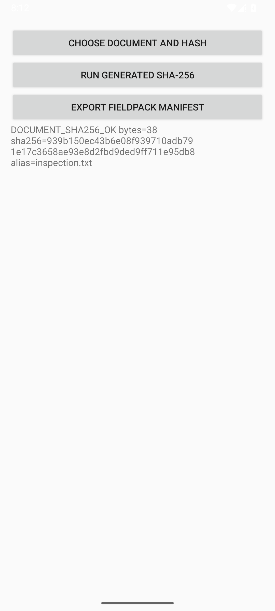
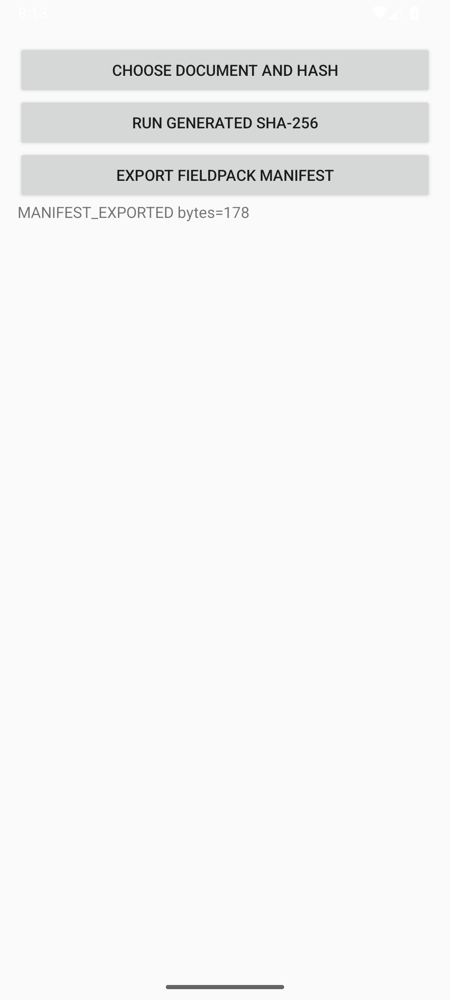

# Reusable library campaign — 31 October 2026

BoundaryLab's core JAR and Android AAR were published to a local Maven folder and
consumed by projects copied outside the source checkout. No Maven Central,
pub.dev or other public registry release occurred. Start with the
[library guide](../../LIBRARY-GUIDE.md) to reproduce the setup.

This campaign starts from repository base `647f1df` with working-tree changes.
The final integration commit was not assigned when these receipts were curated.
The [native source hashes](aosp-host/source-sha256.json) identify the host-check
snapshot; artifact hashes identify the actual package builds. The
[packaged-source comparison](packaged-source-lineage.json) confirms all seven
current core/SDK Kotlin files match the published source JAR bytes. The [final code/build/test source manifest](final-source-sha256.json) records
49 changed source paths at handoff; it excludes documentation to avoid a receipt
cycle. The QA and native source manifests and packaged-source comparisons were
checked against this working tree. Root owns the integration commit. Historical
evidence files remain unchanged.

## What was executed

| Check | Recorded result | Receipt |
|---|---|---|
| Folder Maven publication | Core JAR, Android AAR, POM/module metadata, sources and real Dokka API docs; 53 s | [Build](publication.sanitized.log), [artifact inventory](artifact-inventory.json), [package report](03-packages.sanitized.md) |
| Independent JVM consumer | Real 65,536-byte generated SHA-256 job, independent digest comparison and FieldPack round trip; 11 s | [Execution](consumer-jvm.log) |
| Independent Android consumer build | Default and custom endpoint application/test compilation; SDK transitive core resolved | [Default/dependencies](consumer-android.sanitized.log), [custom app/test](consumer-android-custom.sanitized.log) |
| Copied Flutter package and application | External debug APK build, 33.2 s; no BoundaryLab sibling source dependencies | [APK build](flutter-logs/copied-debug-apk.log), [APK identity](flutter-logs/apk.sanitized.json), [copied-source check](flutter-logs/copied-source-check.sanitized.json) |
| Flutter source and facade checks | Direct Dart analysis passed twice; 2 plugin and 11 example tests passed | [Plugin analysis](flutter-logs/plugin-dart-analyze.log), [example analysis](flutter-logs/example-dart-analyze.log), [plugin tests](flutter-logs/plugin-test.sanitized.log), [example tests](flutter-logs/example-test.sanitized.log) |
| Flutter endpoint configuration | Default/custom BuildConfig checks passed; partial configuration correctly rejected | [Configuration summary](flutter-logs/endpoint-config-checks.sanitized.json), [custom build](flutter-logs/custom-endpoint-config.sanitized.log), [expected rejection](flutter-logs/partial-endpoint-config.sanitized.log) |
| Native host checks | 61 existing Engine checks plus 20 production configuration-policy checks, ASan/UBSan clean; entry-point syntax passed | [Summary](aosp-host/results.json), [Engine output](aosp-host/checks.jsonl), [policy output](aosp-host/service-config-checks.jsonl), [syntax command](aosp-host/entrypoint-syntax.sanitized.json), [environment](aosp-host/environment.txt) |
| Installed Android instrumentation | 46 passing test executions, including repeated endpoint cases; API 35 virtual device | [Runtime matrix below](#android-runtime-scope) |

The Flutter `flutter analyze` wrapper failed because this local SDK expected a
missing `analysis_server.dart.snapshot`; direct `dart analyze` passed using the
installed Dart SDK. The [failure log](flutter-logs/plugin-analyze.sanitized.log)
and [Flutter report](05-flutter.sanitized.md) retain that tooling limitation.
No installed Flutter runtime was executed.

The native checks compile the real production policy helper and existing Engine
on macOS arm64 with Apple Clang 21. They do **not** compile/link Android Binder,
run Soong, compile/load SELinux policy or build/boot a new AOSP image. The
[native report](07-aosp-host.sanitized.md) and
[zero-byte sanitizer outputs](aosp-host/sanitizer.txt) retain the scope. The native
profile remains generated-only; file work returns `UNSUPPORTED`. The historical
30 October custom-image proof applies only to its recorded source revision.

## Android runtime scope

QA verdict: **PASS-WITH-GAPS** for the stated app-broker scope. The
[final QA report](06-qa.sanitized.md) and [machine summary](qa-runtime/summary.json)
separate executed checks from remaining gaps.

QA used a fresh local Android 15 / API 35 ARM64 emulator, with SELinux Enforcing.
It used installed local system-image tooling; no physical device or custom AOSP
image was involved. [Device command](qa-runtime/device-runtime.sanitized.json) ·
[device output](qa-runtime/device-runtime.log).

| Installed check | Passing executions | Receipt |
|---|---:|---|
| Default endpoint, SDK lifecycle and descriptor ownership regressions | 24 | [Runner/transport evidence](qa-runtime/default-regression/broker.json) |
| Configured broker package and owned signature permission | 12 | [Runner/transport evidence](qa-runtime/custom-endpoint/endpoint.json) |
| External same-signer consumer, separate UID/PID, default compatibility, real file descriptor and wrong expected permission | 4 | [Runner, identity and digest evidence](qa-runtime/external-positive/consumer.json) |
| Independently signed incoming client denial | 1 | [Actual bind denial](qa-runtime/incoming-denial/denied-client.json) |
| Installed differently signed broker rejected by outgoing client | 1 | [Actual signer denial](qa-runtime/outgoing-denial/wrong-signer.json) |
| Matched broker restored and external checks repeated | 4 | [Restored positive evidence](qa-runtime/restored-positive/consumer.json) |

These total 46 executions across 30 distinct cases, with zero skipped tests. Controlled-context metadata and
blocked-transport tests within the regression suites establish their modeled SDK
behavior; the separate installed tests establish the stated real package/process
and signer boundaries. Nine separate synthetic parser-only cases passed
([command](qa-runtime/parser-only-tests.sanitized.json),
[output](qa-runtime/parser-only-tests.log)); these are not additional Android
runtime executions. The [strict parser revalidation](qa-runtime/strict-revalidation.json)
checks runner completion, declared counts, unique terminal identities and absence
of failure markers for the initial suites. [APK hashes and public signer certificate
fingerprints](qa-runtime/apk-inventory.sanitized.json) and
[tested source hashes](qa-runtime/tested-source-hashes.json) identify the Android
artifacts/source snapshot. Certificate fingerprints contain no signing key.

## Actual file selection, hash and export

The copied Android consumer selected the synthetic 38-byte `inspection.txt` through
Android's document picker, submitted the descriptor to the custom broker and
exported a 178-byte FieldPack manifest through the SAF create-document flow. These
are actual emulator captures, not mockups; the two screens show successive states.

<table>
  <tr><th>Document hashed by the broker</th><th>Manifest exported</th></tr>
  <tr>
    <td></td>
    <td></td>
  </tr>
</table>

[Hash capture command/hash](qa-runtime/document-hashed-capture.json) ·
[export capture command/hash](qa-runtime/manifest-exported-capture.json) ·
[final package/UID/PID and UI evidence](qa-runtime/final-device-identities-and-ui.json).

The [fixture oracle](qa-runtime/fixtures/oracle.json) records the independently
calculated digest. The exported [manifest](qa-runtime/fixtures/fieldpack.json) and
[attachment](qa-runtime/fixtures/inspection.txt) were verified by the separate
Python recipient: [MATCH, exit 0](qa-runtime/verify-exported-recipient.log)
([command](qa-runtime/verify-exported-recipient.sanitized.json)). Changing the
attachment produced the expected [DIGEST_MISMATCH, exit 1](qa-runtime/recipient-changed.sanitized.json).
This establishes the demonstrated checksum/export handoff; it does not add text
extraction, preview, content trust, durability or new native OS operations.

## Remaining gaps and cleanup

This campaign did not execute Flutter on Android, API 30/API 36 or physical-device
regressions of the current source, a new AOSP/platform image, the broad SAF
cancellation/configuration/provider-loss matrix, asynchronous export-stop stress,
performance or soak. A provider export already started may finish after Activity
stop; stale UI completion is discarded, and that race remains source-reviewed.
One initial QA consumer build used a nonexistent repository folder and failed
resolution; correcting the explicit folder produced the successful final build.
That recovered setup error remains in the raw QA output and report.

The [cleanup receipt](qa-runtime/cleanup.json) confirms the owned emulator stopped,
temporary AVD and disposable signer removed, existing AVDs untouched and final
`adb devices -l` empty. No paid/cloud resources were created. The current app SDK
minimum remains API 30; only the API 35 virtual runtime described here was exercised.

## Receipt integrity and sanitization

[receipt-inventory.json](receipt-inventory.json) records exact byte length and
SHA-256 of every copied receipt, together with its original relative output path,
original length/hash and transformations. Raw originals remain in
`outputs/boundarylab-library-20261031` outside the repository. They were not
rewritten. Copied filenames containing `.sanitized` explicitly identify changed
bytes; unsuffixed copies retain their original bytes.

Sanitization replaces the user's workspace prefix with `/workspace` and remaining
home-directory paths with `/home/USER`. Generated Flutter issue URLs containing
encoded doctor/local-device inventory were removed from the wrapper failure log;
the actual failure diagnostic remains. Sanitized copies therefore have their own
hashes and are not presented as byte-identical originals. Paths shown in copied
reports/logs describe this relocation convention, not a second execution.

This folder excludes APK/native binaries, AVD disks, broad emulator logs, private
signer preparation/environment files and unrelated device inventory. Public
package names, synthetic fixture names, observed UIDs/PIDs, digest values and
signature-denial observations are retained because they support the boundary
checks. No signing key or password is included.
